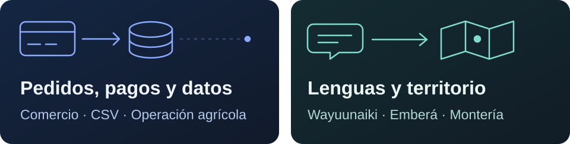

# Andrés Arteaga Ramos

Soy desarrollador de software, instructor full stack en Códica y licenciado en Informática por la Universidad de Córdoba. Construyo APIs, integro sistemas de pago y desarrollo herramientas para procesar datos. También he trabajado en algoritmos de traducción asistidos por IA para lenguas nativas de Colombia.

**Montería, Colombia** · Inglés B1 · **[Portafolio profesional ↗](https://software-studio-tau.vercel.app/portafolio)**

[Experiencia](#experiencia) · [Proyectos públicos](#proyectos-públicos) · [Stack](#stack) · [Software Studio](#andrés-arteaga-software-studio)

## Experiencia

**Instructor full stack · Códica**  
ago 2025 — actualidad · remoto

Formación en lógica, bases de datos, frontend, backend y despliegue.

**Líder de desarrollo · Hi Beauty**

noviembre de 2025 — 31 de diciembre de 2025 · presencial

Backend en NestJS y Redis para notificaciones por correo, WhatsApp, push y SMS. Integraciones de pago con Wompi, Treli, Rebill, PayPal y Stripe. AWS (S3 y EC2) y coordinación del equipo técnico.

Ver experiencia anterior

**Desarrollador de software · IDEAS S.A.S**  
jun 2024 — sep 2025 · remoto

Sitios y comercios con React, Astro y Supabase. Tiendas en .NET con arquitectura limpia, SQL Server y Wompi. APIs en Express y mantenimiento de servidores.

**Investigador · Grupo Lexicón, Universidad de Córdoba**  
ene 2023 — feb 2024

Traducción para emberá y wayuunaiki, diccionarios y el mapa sociolingüístico de Montería.

**Desarrollador web · Medicall24 S.A.S**  
ene 2022 — nov 2022 · presencial

Comercio de planes, exámenes y consultas con React, TypeScript, Supabase y PostgreSQL. Pagos con Wompi y correos con SendGrid.

## Proyectos públicos

### Datos, pagos y operaciones

- **[processing-data-rust](https://github.com/AnDevArteaga/processing-data-rust)** — Motor en Rust para el procesamiento masivo de datos en CSV. Lee los archivos en streaming y usa una cola de trabajos para normalizar registros y eliminar duplicados.
- **[Orders Platform](https://github.com/AnDevArteaga/orders-platform)** — API de pedidos y cobros concurrentes con Wompi. Verifica la firma y el monto de las notificaciones de pago antes de actualizar el pedido. El pago se realiza en Wompi.
- **[Cerdital](https://github.com/AnDevArteaga/Cerdital-g-Backend)** — API en producción para operaciones. Gestiona lotes, alimentación, sanidad, pesajes, costos y ventas.

### Inteligencia artificial aplicada a la traducción de lenguas nativas de Colombia

- **[TranslateAlgorithm](https://github.com/AnDevArteaga/TranslateAlgorithm)** — Algoritmo de traducción entre español y wayuunaiki. Combina un diccionario con un modelo de IA que interviene cuando falta una palabra.
- **[Traductor de lenguas nativas](https://github.com/AnDevArteaga/Traductor-Lenguas-Indigenas)** — Interfaz web para traducir wayuunaiki y emberá.

### Otros proyectos de investigación
- **[Mapa sociolingüístico](https://github.com/AnDevArteaga/Mapa-Sociolinguistico)** — Mapa interactivo de Montería.
- **[Diccionario del Alto Sinú y San Jorge](https://github.com/AnDevArteaga/diccionario-electrnico)** — Diccionario electrónico de la región.

## Stack

**Frontend.** React, Next.js, TypeScript, JavaScript, HTML/CSS, Tailwind CSS y Astro.

**Backend.** Node.js, Express, NestJS, C# / ASP.NET Core y Python.

**Datos.** PostgreSQL, Supabase, MySQL, MongoDB, Firebase, SQL Server y Redis.

**Inteligencia artificial.** APIs de modelos de lenguaje, n8n y salidas estructuradas, cuando el problema lo justifica.

**Herramientas.** Git, GitHub, Docker, REST APIs y AWS (S3 y EC2).

## Andrés Arteaga Software Studio

Mi estudio desarrolla software, inteligencia artificial y automatización para emprendedores, negocios y empresas. Uso IA cuando ayuda a resolver una necesidad concreta.

| Área | Qué construyo |
| :--- | :--- |
| **Software a medida** | Sistemas administrativos, APIs e integraciones con pasarelas de pago. |
| **Web y comercio electrónico** | Sitios, tiendas y plataformas que conectan el catálogo con los pedidos y el cobro. |
| **Automatización** | Flujos que conectan formularios, correo, CRM y bases de datos para reducir el trabajo manual. |
| **Inteligencia artificial aplicada** | Consulta de documentos, extracción de datos y asistentes con opción de pasar la conversación a una persona. |

**[Visitar el sitio del estudio ↗](https://software-studio-tau.vercel.app)**

### Contacto

Si tienes un proceso que automatizar o un producto que quieres construir, cuéntame qué necesitas resolver.

[Correo del estudio](mailto:andresarteagasoftwarestudio@gmail.com) · [WhatsApp](https://wa.me/573182448598?text=Hola%2C%20Andr%C3%A9s.%20Quiero%20conversar%20sobre%20un%20proyecto%20de%20software.) · [Instagram](https://www.instagram.com/andresarteagastudio)
