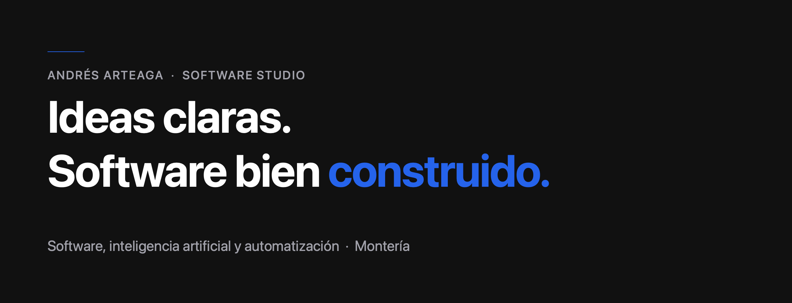

# Andrés Arteaga Software Studio

**Ideas claras. Software bien construido.**

Soy Andrés Arteaga, licenciado en Informática por la Universidad de Córdoba. Con el estudio desarrollo software, inteligencia artificial y automatización para emprendedores, negocios y empresas. La inteligencia artificial entra cuando aporta algo concreto al negocio. Si no hace falta, la solución sigue siendo software tradicional.

Licenciado en Informática · Inglés B1 · Montería, Colombia

## Sitio y portafolio

**[Sitio del estudio](https://software-studio-tau.vercel.app)**  
La página comercial: servicios, ejemplos y solicitud de cotización.

**[Portafolio profesional](https://software-studio-tau.vercel.app/portafolio)**  
El recorrido laboral, los proyectos públicos y el stack.

## Servicios

La oferta combina software tradicional con inteligencia artificial, según la necesidad y el presupuesto.

1. **Inteligencia artificial aplicada a negocios.** Asistentes, consulta de documentos y extracción de información dentro de una aplicación.
2. **Automatización de procesos con IA.** Flujos que conectan formularios, correos, CRM y bases de datos para quitar tareas manuales.
3. **Chatbots y asistentes virtuales.** Consultas frecuentes y captación de clientes, con paso a una persona cuando hace falta.
4. **Desarrollo web y comercio electrónico.** Páginas, tiendas virtuales y plataformas, con funciones inteligentes si el proyecto las justifica.
5. **Software a medida e integraciones.** Sistemas administrativos, APIs, pasarelas de pago y arquitectura.

## Experiencia

**Líder de desarrollo · Hi Beauty**  
oct 2025 — actualidad · presencial

Backend en NestJS y Redis para notificaciones por correo, WhatsApp, push y SMS. Integraciones de pago con Wompi, Treli, Rebill, PayPal y Stripe. AWS (S3 y EC2) y coordinación del equipo técnico.

**Instructor full stack · Códica**  
ago 2025 — actualidad · remoto

Formación en lógica, bases de datos, frontend, backend y despliegue.

**Desarrollador de software · IDEAS S.A.S**  
jun 2024 — sep 2025 · remoto

Sitios y comercios con React, Astro y Supabase. Tiendas en .NET con arquitectura limpia, SQL Server y Wompi. APIs en Express y mantenimiento de servidores.

**Investigador · Grupo Lexicón, Universidad de Córdoba**  
ene 2023 — feb 2024

Traducción para emberá y wayuunaiki, diccionarios y el mapa sociolingüístico de Montería.

**Desarrollador web · Medicall24 S.A.S**  
ene 2022 — nov 2022 · presencial

Comercio de planes, exámenes y consultas con React, TypeScript, Supabase y PostgreSQL. Pagos con Wompi y correos con SendGrid.

## Proyectos públicos

- **[Orders Platform](https://github.com/AnDevArteaga/orders-platform).** Pedidos y cobros. El comprador paga en Wompi y la tienda no guarda la tarjeta.
- **[processing-data-rust](https://github.com/AnDevArteaga/processing-data-rust).** Limpieza de CSV por trabajos, con cola y créditos.
- **[Cerdital](https://github.com/AnDevArteaga/Cerdital-g-Backend).** API de la app de granja: lotes, alimentación, sanidad, costos y ventas.
- **[TranslateAlgorithm](https://github.com/AnDevArteaga/TranslateAlgorithm).** Traducción entre español y wayuunaiki. Diccionario primero; el modelo solo si la palabra no está.
- **[Traductor de lenguas indígenas](https://github.com/AnDevArteaga/Traductor-Lenguas-Indigenas).** Página de ese traductor. Wayuunaiki y emberá.
- **[Mapa sociolingüístico](https://github.com/AnDevArteaga/Mapa-Sociolinguistico).** Mapa interactivo de Montería.
- **[Diccionario del Alto Sinú y San Jorge](https://github.com/AnDevArteaga/diccionario-electrnico).** Diccionario electrónico de la región.

## Stack

**Frontend.** React, Next.js, TypeScript, JavaScript, HTML/CSS, Tailwind CSS y Astro.

**Backend.** Node.js, Express, NestJS, C# / ASP.NET Core y Python.

**Datos.** PostgreSQL, Supabase, MySQL, MongoDB, Firebase, SQL Server y Redis.

**Inteligencia artificial.** APIs de modelos de lenguaje, n8n y salidas estructuradas, cuando el problema lo justifica.

**Herramientas.** Git, GitHub, Docker, REST APIs y AWS (S3 y EC2).

## Contacto

[Correo del estudio](mailto:andresarteagasoftwarestudio@gmail.com) · [WhatsApp](https://wa.me/573182448598?text=Hola%2C%20Andr%C3%A9s.%20Quiero%20conversar%20sobre%20un%20proyecto%20de%20software.) · [Instagram](https://www.instagram.com/andresarteagastudio)
