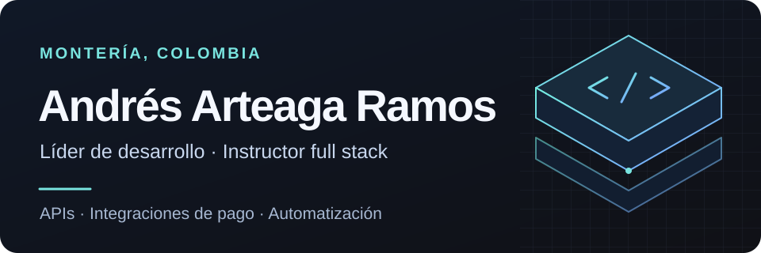
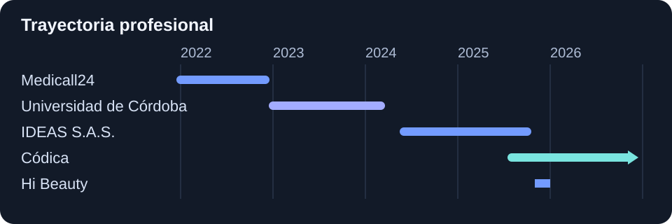

# Andrés Arteaga Ramos

Soy desarrollador de software, instructor full stack en Códica y licenciado en Informática por la Universidad de Córdoba. Construyo APIs, integro sistemas de pago y desarrollo herramientas para procesar datos. También he trabajado en algoritmos de traducción asistidos por IA para lenguas nativas de Colombia.

**Montería, Colombia** · Inglés B1 · **[Portafolio profesional ↗](https://software-studio-tau.vercel.app/portafolio)**

[Experiencia](#experiencia) · [Proyectos públicos](#proyectos-públicos) · [Stack](#stack) · [Software Studio](#andrés-arteaga-software-studio)

## Experiencia

**Instructor full stack · Códica**  
ago 2025 — actualidad · remoto

Enseño a construir una aplicación de punta a punta: plantear la lógica, modelar los datos, implementar el backend, conectar la interfaz y desplegar el resultado.

**Líder de desarrollo · Hi Beauty**

noviembre de 2025 — 31 de diciembre de 2025 · presencial

- **Notificaciones.** Trabajé en el backend con NestJS y Redis para enviar notificaciones por correo, WhatsApp, push y SMS.
- **Pagos.** Integré Wompi, Treli, Rebill, PayPal y Stripe en los flujos de cobro.
- **Infraestructura y equipo.** Trabajé con EC2 y S3 en AWS y coordiné el trabajo del equipo técnico.

Ver experiencia anterior

**Desarrollador de software · IDEAS S.A.S**  
jun 2024 — sep 2025 · remoto

Desarrollé tiendas en .NET con arquitectura limpia. Separé las reglas de negocio y los casos de uso de la persistencia en SQL Server y de la integración con Wompi. También construí sitios con React, Astro y Supabase, desarrollé APIs en Express y mantuve servidores.

**Investigador · Grupo Lexicón, Universidad de Córdoba**  
ene 2023 — feb 2024

Desarrollé herramientas de traducción para emberá y wayuunaiki, diccionarios digitales y un mapa sociolingüístico de Montería. En el mapa, la interfaz combina las capas geográficas de las comunas con una API que entrega los términos de cada zona.

**Desarrollador web · Medicall24 S.A.S**  
ene 2022 — nov 2022 · presencial

Construí el flujo de compra de planes, exámenes y consultas con una interfaz en React y TypeScript y una capa de datos en Supabase sobre PostgreSQL. Integré Wompi para el cobro y SendGrid para las comunicaciones por correo.

## Proyectos públicos

### Datos, pagos y operaciones

**[processing-data-rust](https://github.com/AnDevArteaga/processing-data-rust)**

Motor para procesar CSV masivos en streaming. El mismo núcleo de limpieza se ejecuta desde la línea de comandos o desde un worker. La API recibe los archivos y encola las tareas, y SQLite guarda el estado de los trabajos.

 Rust ·  SQLite

**[Orders Platform](https://github.com/AnDevArteaga/orders-platform)**

API para gestionar pedidos y cobros concurrentes. Separa dominio, casos de uso, infraestructura y API HTTP. Verifica la firma y el importe del aviso de Wompi antes de actualizar el pedido y envía al comercio un webhook firmado.

 C# ·  ASP.NET Core ·  SQLite

**[Pasarela de pago multimétodo](https://github.com/AnDevArteaga/pasarela-de-pago-multi-metodos)**

Checkout independiente para pagos únicos y suscripciones, con tarjeta, PSE, Nequi y botón Bancolombia a través de Wompi. La API valida el precio en su propia base PostgreSQL, verifica la firma del enlace de checkout y notifica el resultado al sistema de origen mediante webhooks. React y la API .NET 8 se despliegan juntos en Docker.

 .NET 8 ·  React ·  TypeScript ·  PostgreSQL ·  Docker

**[Cerdital](https://github.com/AnDevArteaga/Cerdital-g-Backend)**

API en producción para operaciones. Gestiona lotes, alimentación, sanidad, pesajes, costos y ventas. Organiza el backend en rutas HTTP, servicios con reglas de negocio y repositorios de datos. Usa Redis como caché de consultas.

 Node.js ·  TypeScript ·  PostgreSQL ·  Redis

### Inteligencia artificial aplicada a la traducción de lenguas nativas de Colombia

**[TranslateAlgorithm](https://github.com/AnDevArteaga/TranslateAlgorithm)**

Servicio de traducción entre español y wayuunaiki. Consulta primero el diccionario y, si falta una palabra, genera una propuesta con un modelo secuencia a secuencia entrenado en PyTorch. La API marca esas propuestas como aproximaciones.

 Python ·  PyTorch ·  FastAPI

**[Traductor de lenguas nativas](https://github.com/AnDevArteaga/Traductor-Lenguas-Indigenas)**

Interfaz web que consulta el servicio de traducción y muestra los resultados en español o wayuunaiki.

 Vue ·  Vite

### Otros proyectos de investigación

**[Mapa sociolingüístico](https://github.com/AnDevArteaga/Mapa-Sociolinguistico)**

Mapa interactivo de Montería que combina capas geográficas con términos lingüísticos por comuna.

 Next.js ·  TypeScript ·  Tailwind CSS

**[Diccionario del Alto Sinú y San Jorge](https://github.com/AnDevArteaga/diccionario-electrnico)**

Diccionario digital para consultar el léxico del Alto Sinú y San Jorge.

 Next.js ·  TypeScript ·  Tailwind CSS

## Stack

**Frontend.** React, Next.js, TypeScript, JavaScript, HTML/CSS, Tailwind CSS y Astro.

**Backend.** Node.js, Express, NestJS, C# / ASP.NET Core y Python.

**Datos.** PostgreSQL, Supabase, MySQL, MongoDB, Firebase, SQL Server y Redis.

**Inteligencia artificial.** APIs de modelos de lenguaje, n8n y salidas estructuradas, cuando el problema lo justifica.

**Herramientas.** Git, GitHub, Docker, REST APIs y AWS (S3 y EC2).

## Andrés Arteaga Software Studio

Mi estudio desarrolla software, inteligencia artificial y automatización para emprendedores, negocios y empresas. Uso IA cuando ayuda a resolver una necesidad concreta.

| Área | Qué construyo |
| :--- | :--- |
| **Software a medida** | Sistemas administrativos, APIs e integraciones con pasarelas de pago. |
| **Web y comercio electrónico** | Sitios, tiendas y plataformas que conectan el catálogo con los pedidos y el cobro. |
| **Automatización** | Flujos que conectan formularios, correo, CRM y bases de datos para reducir el trabajo manual. |
| **Inteligencia artificial aplicada** | Consulta de documentos, extracción de datos y asistentes con opción de pasar la conversación a una persona. |

**[Visitar el sitio del estudio ↗](https://software-studio-tau.vercel.app)**

### Contacto

Si tienes un proceso que automatizar o un producto que quieres construir, cuéntame qué necesitas resolver.

[Correo del estudio](mailto:andresarteagasoftwarestudio@gmail.com) · [WhatsApp](https://wa.me/573182448598?text=Hola%2C%20Andr%C3%A9s.%20Quiero%20conversar%20sobre%20un%20proyecto%20de%20software.) · [Instagram](https://www.instagram.com/andresarteagastudio)
